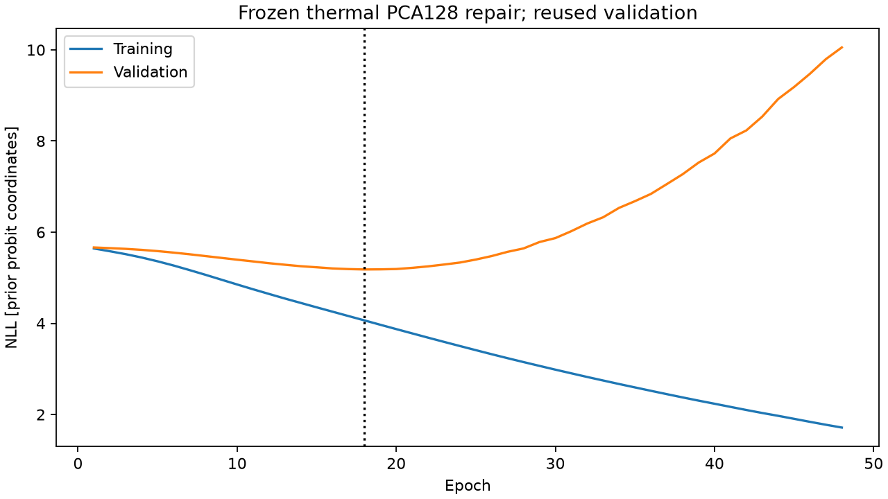
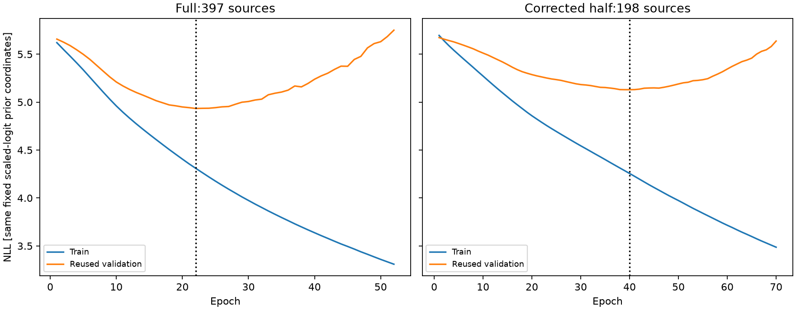
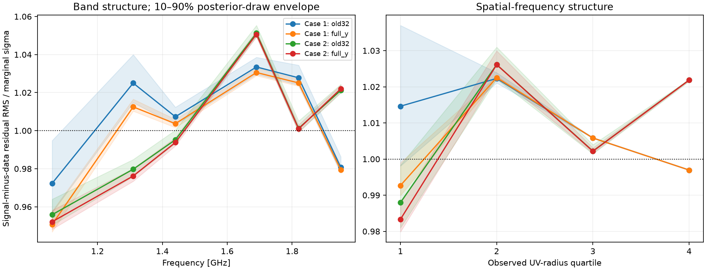

# Published experiment record

These are sanitized copies of existing results, not newly generated scientific results. JSON fields containing identities, truths, protected seeds and raw parameter draws are omitted. Local-original hashes are retained as provenance and do not authenticate the redacted copies; the publication manifest gives separate hashes for both. Raw arrays/checkpoints and large bindings stay local. Reused validation and already-scored test results are labelled explicitly.

| Stage | Result and procedural progress |
|---|---|
| Original experiment | [Full training receipt](ml_initial_20261023/run_03/full/training.json), [every epoch](ml_initial_20261023/run_03/full/epochs.jsonl), [historical half diagnostic](ml_initial_20261023/run_03/half_diagnostic/training.json), [archived test aggregates](ml_initial_20261023/run_03/test_evaluation.json) |
| Followup | [Report](ml_initial_20261023/followup_01/REPORT.md), [summary](ml_initial_20261023/followup_01/summary.json), exact replay timings and epoch history |
| Earlier audit | [Before issues](ml_initial_20261023/review_01/ISSUES_BEFORE.md), [consolidated before/after](ml_initial_20261023/review_01/final_01/BEFORE_AFTER.md), conditional continuation and PA repair receipts, probit probe, model diagnosis and predictive residuals |
| Latest repair | [Before/after](ml_initial_20261023/repair_02/BEFORE_AFTER.md), [summary](ml_initial_20261023/repair_02/SUMMARY.json), [failed/accepted timing ledger](ml_initial_20261023/repair_02/failure_timing_ledger.json), [incidents](ml_initial_20261023/repair_02/INCIDENTS.json), training epoch logs, half-data correction, stress diagnostics and preserved seal metadata |
| Verification | [77 passing regressions](ml_initial_20261023/repair_02/regressions.txt), [local final verification copy](ml_initial_20261023/repair_02/FINAL_VERIFICATION.json), [publication manifest](../PUBLICATION_MANIFEST.json) |

The canonical network remains epoch22/stop52. The new thermal PCA128 fit selected epoch18/stop48 and was rejected after worse validation density/errors. Two matched compressed and two full-data Bayesian cases pass the declared diagnostics; optional PCA128 Bayesian routes were deferred, not failed or validated. Failed phases remain represented. Two cases/four conditional draws cannot establish broad calibration. No new test scoring, protected-bank generation or real-data training occurred in the repair campaign.

The original half-data run used full-training feature normalization; the corrected half run fits its own 198-source preprocessing. Existing test statistics come from the original 96 observations/48 sources and are not a new blind evaluation. The 24 different-layout challenge observations were not scored.

## Included and excluded

Publication includes bounded text/JSON/JSONL aggregate results, diagnostics and experiment histories plus five reviewed PNG figures. Original simulator/data/model artifacts are untouched. This is a selective public progress record, not a full executable backup of private scientific assets. Task prompts are absent from the new main tree; older Git commits and the retained checkpoint branch can still contain their historical versions. No history was rewritten and no branch was deleted.
