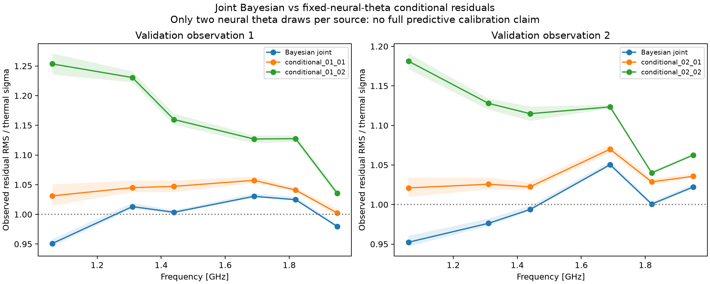

> Sanitized publication copy. Private identities, labels, machine paths and task prompts are omitted. Original hashes below identify local originals, not these edited copies. Some linked raw artifacts are intentionally local-only.

## Additional exploratory band/radius residual checks

Global residual energy is not an omnibus check. Using the SAME accepted posterior samples and exact replicate-noise streams, this validation-only analysis groups raw residuals by band and operator-defined Fourier-radius quartiles. Thermal per-component sigma includes the self-mode factor; replicate noise retains the cross-frequency covariance. Groups are correlated. These are exploratory posterior checks, not population calibration or new model fitting.

| Case/posterior | Group | Median observed RMS / thermal sigma | Replicate tail fraction |
|---|---|---:|---:|
| 1: Bayesian joint | band_0 | 0.9510 | 0.8672 |
| 1: Bayesian joint | band_1 | 1.0130 | 0.4141 |
| 1: Bayesian joint | band_2 | 1.0035 | 0.5625 |
| 1: Bayesian joint | band_3 | 1.0304 | 0.1016 |
| 1: Bayesian joint | band_4 | 1.0247 | 0.1094 |
| 1: Bayesian joint | band_5 | 0.9796 | 0.8125 |
| 1: Bayesian joint | radius_0 | 0.9927 | 0.6406 |
| 1: Bayesian joint | radius_1 | 1.0226 | 0.1875 |
| 1: Bayesian joint | radius_2 | 1.0058 | 0.4375 |
| 1: Bayesian joint | radius_3 | 0.9970 | 0.5391 |
| 1: conditional_01_01 | band_0 | 1.0312 | 0.2812 |
| 1: conditional_01_01 | band_1 | 1.0450 | 0.0625 |
| 1: conditional_01_01 | band_2 | 1.0472 | 0.0625 |
| 1: conditional_01_01 | band_3 | 1.0573 | 0.0156 |
| 1: conditional_01_01 | band_4 | 1.0410 | 0.0938 |
| 1: conditional_01_01 | band_5 | 1.0023 | 0.5312 |
| 1: conditional_01_01 | radius_0 | 1.1097 | 0.0000 |
| 1: conditional_01_01 | radius_1 | 1.0238 | 0.2969 |
| 1: conditional_01_01 | radius_2 | 1.0058 | 0.3906 |
| 1: conditional_01_01 | radius_3 | 0.9970 | 0.5781 |
| 1: conditional_01_02 | band_0 | 1.2535 | 0.0000 |
| 1: conditional_01_02 | band_1 | 1.2306 | 0.0000 |
| 1: conditional_01_02 | band_2 | 1.1598 | 0.0000 |
| 1: conditional_01_02 | band_3 | 1.1270 | 0.0000 |
| 1: conditional_01_02 | band_4 | 1.1275 | 0.0000 |
| 1: conditional_01_02 | band_5 | 1.0356 | 0.0625 |
| 1: conditional_01_02 | radius_0 | 1.4033 | 0.0000 |
| 1: conditional_01_02 | radius_1 | 1.0708 | 0.0000 |
| 1: conditional_01_02 | radius_2 | 1.0101 | 0.3281 |
| 1: conditional_01_02 | radius_3 | 0.9981 | 0.5000 |
| 2: Bayesian joint | band_0 | 0.9524 | 0.9062 |
| 2: Bayesian joint | band_1 | 0.9763 | 0.7344 |
| 2: Bayesian joint | band_2 | 0.9937 | 0.5859 |
| 2: Bayesian joint | band_3 | 1.0504 | 0.0312 |
| 2: Bayesian joint | band_4 | 1.0006 | 0.4922 |
| 2: Bayesian joint | band_5 | 1.0222 | 0.1719 |
| 2: Bayesian joint | radius_0 | 0.9829 | 0.7031 |
| 2: Bayesian joint | radius_1 | 1.0259 | 0.1406 |
| 2: Bayesian joint | radius_2 | 1.0023 | 0.4297 |
| 2: Bayesian joint | radius_3 | 1.0218 | 0.1875 |
| 2: conditional_02_01 | band_0 | 1.0211 | 0.3125 |
| 2: conditional_02_01 | band_1 | 1.0257 | 0.2188 |
| 2: conditional_02_01 | band_2 | 1.0224 | 0.2344 |
| 2: conditional_02_01 | band_3 | 1.0700 | 0.0000 |
| 2: conditional_02_01 | band_4 | 1.0287 | 0.0781 |
| 2: conditional_02_01 | band_5 | 1.0357 | 0.0469 |
| 2: conditional_02_01 | radius_0 | 1.0900 | 0.0000 |
| 2: conditional_02_01 | radius_1 | 1.0272 | 0.1875 |
| 2: conditional_02_01 | radius_2 | 1.0080 | 0.4219 |
| 2: conditional_02_01 | radius_3 | 1.0206 | 0.1562 |
| 2: conditional_02_02 | band_0 | 1.1813 | 0.0000 |
| 2: conditional_02_02 | band_1 | 1.1279 | 0.0000 |
| 2: conditional_02_02 | band_2 | 1.1149 | 0.0000 |
| 2: conditional_02_02 | band_3 | 1.1234 | 0.0000 |
| 2: conditional_02_02 | band_4 | 1.0400 | 0.0156 |
| 2: conditional_02_02 | band_5 | 1.0626 | 0.0000 |
| 2: conditional_02_02 | radius_0 | 1.2655 | 0.0000 |
| 2: conditional_02_02 | radius_1 | 1.0694 | 0.0000 |
| 2: conditional_02_02 | radius_2 | 1.0010 | 0.3906 |
| 2: conditional_02_02 | radius_3 | 1.0221 | 0.1250 |

Each neural curve conditions on ONE original frozen theta draw and integrates the latest accepted nuisance posterior. Shading is variation across its conditional nuisance samples, not a full neural marginal predictive interval. Low tail fractions can identify an awkward theta draw; four draws cannot estimate how often the neural posterior makes that error. No outer draw was removed or replaced.
