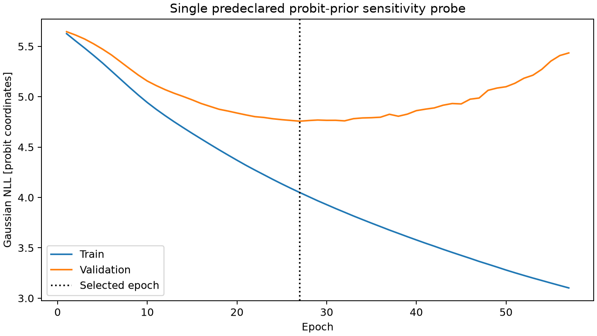

> Sanitized publication copy. Private identities, labels, machine paths and task prompts are omitted. Original hashes below identify local originals, not these edited copies. Some linked raw artifacts are intentionally local-only.

# Single frozen-budget probit target-transform probe

**Development comparison only. The original model remains the comparison model; no test scoring or automatic replacement.**

Only the target transform changed: probit(prior-unit) replaces scaled logit(prior-unit). The same 794 training observations /397 sources, 134 validation observations /67 sources, PCA32, hidden32, seed 231026, optimizer and stopping protocol were used. A Gaussian probit posterior can exactly represent the uninformative uniform prior at zero mean/identity covariance; it still cannot represent arbitrary multimodal or curved conditionals. PCA arrays reproduced exactly. Protocol and source hashes were saved BEFORE training.

| Target | Unit | Frozen model MAE | Probit probe MAE | Prior median MAE | Probe RMSE | MAE change vs frozen, source-resampling 95% interval |
|---|---|---:|---:|---:|---:|---|
| em0_pc_cm6 | pc cm^-6 | 33718 | 32218.8 | 87035.2 | 63823.8 | -1499.23 [-2593.13, -402.514] |
| te_k | K | 1832.04 | 1831.85 | 1788.08 | 2051.75 | -0.19145 [-13.9749, 13.4094] |
| major_fwhm_arcsec | arcsec (full major EM FWHM) | 7.53589 | 7.57307 | 11.4158 | 10.2407 | 0.0371801 [-0.115252, 0.179775] |
| axis_ratio | 1 | 0.130725 | 0.129264 | 0.128671 | 0.148026 | -0.00146137 [-0.00286297, -0.000172245] |

Joint density NLL in common prior-unit coordinates (uniform prior=0): frozen -0.694412; probe -0.926993; change -0.232581 with source-resampling interval [-0.36923732576900214, -0.08436833334464373]. Label Jacobians were included, so different target coordinates are not compared by raw Gaussian NLL.

| Target | Level | Coverage | Mean width in stated physical units |
|---|---:|---:|---:|
| em0_pc_cm6 | 50% | 55.22% | 59463.9 |
| em0_pc_cm6 | 80% | 87.31% | 113849 |
| em0_pc_cm6 | 95% | 91.79% | 176134 |
| te_k | 50% | 43.28% | 3404.87 |
| te_k | 80% | 80.60% | 5476.59 |
| te_k | 95% | 95.52% | 6561.08 |
| major_fwhm_arcsec | 50% | 58.96% | 15.3698 |
| major_fwhm_arcsec | 80% | 84.33% | 27.0036 |
| major_fwhm_arcsec | 95% | 93.28% | 36.17 |
| axis_ratio | 50% | 44.78% | 0.227329 |
| axis_ratio | 80% | 73.88% | 0.373046 |
| axis_ratio | 95% | 91.79% | 0.45705 |

Selected epoch 27; stopped epoch 57. These are selected on reused validation sources; coverage and paired resampling intervals are descriptive development evidence. Small error changes can reflect statistical uncertainty. No heldout test comparison, new protected set, hyperparameter sweep or second score-driven fit was performed.

One development sensitivity probe only; no automatic promotion or blind generalization claim. Report all parameter/density/coverage changes. This changes prior representability, not raw data information or family flexibility.

The frozen original neural outer predictive draws and all conditional pilot/continuation evidence remain untouched; this probe has not undergone that full conditional predictive experiment.
